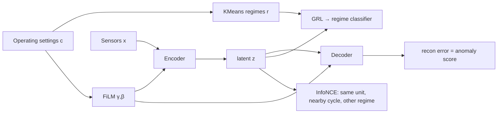
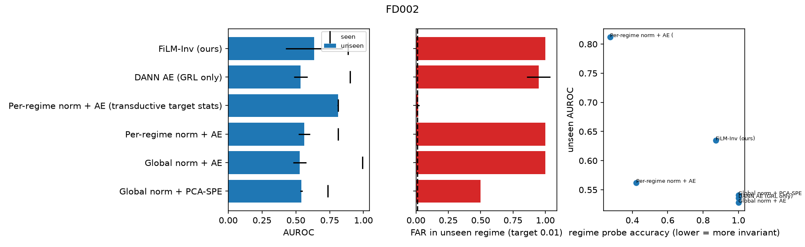
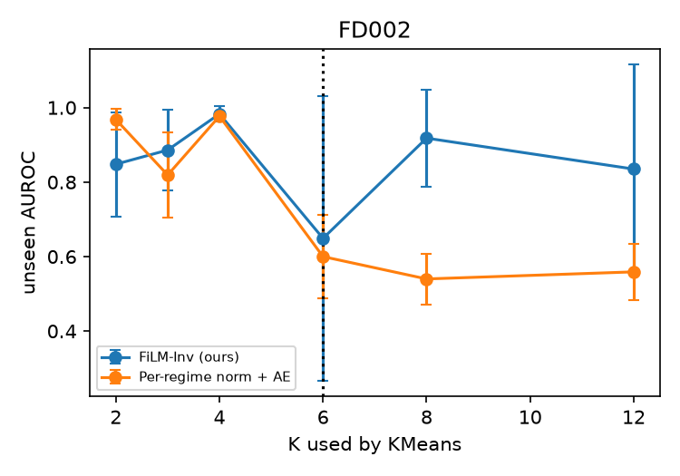
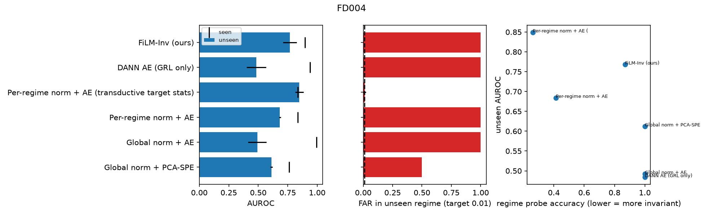

# RegimeShift-Invariant — Operating-Condition-Invariant Anomaly Detection for Industrial Time Series

**Author:** Hossein Tabasi · MIT License

Industrial assets run in several **operating regimes**: altitude, load, throttle, recipe. A detector trained on normal data from some
regimes tends to raise alarms as soon as the asset enters a regime it has never seen. This repo studies that failure mode on
NASA C-MAPSS FD002/FD004 (six flight conditions) with a strict **leave-one-regime-out** protocol. It proposes **FiLM-Inv**, an
autoencoder that is *conditioned* on operating settings (FiLM) and trained to make its latent code *invariant* to the regime
(cross-regime InfoNCE + gradient-reversal regime confusion).

## Method
Input: one cycle x ∈ ℝ^d (non-constant sensors) and operating settings c ∈ ℝ³ (standardized with the KMeans regime statistics, clipped).

- **Regime discovery:** KMeans with K clusters (`n_regimes`) on the settings of *training* data only.
- **FiLM-conditioned AE:** h = W₁x, h̃ = (1+γ(c)) ⊙ h + β(c), z = W₂ ReLU(h̃). The decoder is conditioned the same way. The
  FiLM layers start at the identity.
- **Loss:**
  L = ‖x − x̂‖² + λ_inv · InfoNCE(z_t, z_{t'}) + CE(g(GRL_λ(z)), r).
  The positive pair (t, t') is the same unit within ±3 cycles but in a **different regime**, so the code has to keep the health
  state and drop the regime. GRL is the gradient-reversal layer with a ramped λ ≤ `confusion`.
- **Score:** the reconstruction error. The threshold is the (1 − `false_alarm_target`) quantile of training normal scores.



## Data and protocol
- C-MAPSS (Saxena & Goebel, 2008, NASA PCoE). Files `train_FD002.txt` and `train_FD004.txt`. `scripts/download_data.sh` fetches
  them from a public mirror.
- Labels per cycle: normal = RUL ≥ 100, anomaly (degraded) = RUL ≤ 20; cycles in between are excluded.
- Units are split 70/30 per seed. Training uses only **normal cycles of training units in 5 of the 6 true conditions**. Evaluation
  uses test units in seen conditions and in the held-out condition. Results are averaged over all 6 held-out conditions and then
  reported as mean ± std over seeds 0, 1, 2.
- Baselines:
  - global z-norm + PCA-SPE
  - global z-norm + AE
  - per-regime z-norm + AE (the standard C-MAPSS practice; an unseen regime gets the stats of its nearest seen cluster)
  - DANN AE (GRL only)
  - an **oracle-like transductive** per-regime AE that is allowed to compute normalization stats from unlabeled cycles of the
    unseen regime

## Quickstart
```bash
pip install -r requirements.txt && pip install -e .
bash scripts/download_data.sh && export INDUSTRIAL_TS_DATA=data/raw
python3 -m pytest -q                         # 7 tests
python3 scripts/run_all.py FD002 E1 E4 E5    # ~35 min CPU
python3 scripts/run_all.py FD004 E1
python3 scripts/aggregate.py                 # summaries, figures, reports/RESULTS.md
```

## Results — FD002 (numbers from `experiments/results/*FD002*`)

### E1 unseen-regime detection, E2 false alarms after a regime switch, E3 invariance
| Method | AUROC unseen | AUROC seen | FAR seen | FAR unseen | FAR 1st cycle after switch | Regime-probe acc (↓ = more invariant) |
|---|---|---|---|---|---|---|
| Global norm + PCA-SPE | 0.541 ± 0.010 | 0.736 ± 0.002 | 0.011 | 0.500 | 0.500 | 1.000 |
| Global norm + AE | 0.528 ± 0.049 | **0.994 ± 0.002** | 0.013 | 1.000 | 1.000 | 1.000 |
| Per-regime norm + AE | 0.562 ± 0.044 | 0.811 ± 0.008 | 0.011 | 1.000 | 1.000 | 0.422 |
| DANN AE (GRL only) | 0.536 ± 0.051 | 0.900 ± 0.027 | 0.012 | 0.948 | 0.948 | 1.000 |
| **FiLM-Inv (ours)** | **0.635 ± 0.211** | 0.885 ± 0.019 | 0.012 | 1.000 | 1.000 | 0.872 |
| *Transductive per-regime AE (uses unseen-regime stats)* | *0.812 ± 0.005* | *0.811* | *0.011* | *0.017* | *0.017* | *0.274* |

AUROC on the unseen condition, broken down by held-out condition (seed mean):

| Method | 0 | 1 | 2 | 3 | 4 | 5 |
|---|---|---|---|---|---|---|
| FiLM-Inv | 0.513 | 0.778 | 0.751 | 0.785 | 0.623 | 0.359 |
| Per-regime norm + AE | 0.292 | 0.185 | 0.500 | 0.908 | 0.642 | 0.845 |
| Global norm + PCA-SPE | 0.962 | 0.899 | 0.407 | 0.093 | 0.499 | 0.389 |
| Transductive per-regime AE | 0.699 | 0.958 | 0.746 | 0.986 | 0.860 | 0.620 |



### E4 misspecified number of regimes K (held-out conditions 0 and 3; true K = 6)
| K | Per-regime norm + AE | FiLM-Inv |
|---|---|---|
| 2 | 0.968 ± 0.028 | 0.848 ± 0.140 |
| 3 | 0.819 ± 0.114 | 0.886 ± 0.109 |
| 4 | 0.977 ± 0.010 | 0.983 ± 0.021 |
| 6 | 0.600 ± 0.112 | 0.649 ± 0.382 |
| 8 | 0.540 ± 0.068 | **0.918 ± 0.130** |
| 12 | 0.559 ± 0.076 | **0.835 ± 0.280** |

The per-regime baseline degrades sharply when K is over-specified (K ≥ 6). FiLM-Inv conditions on the continuous settings, so it
is much less sensitive to K. FAR in the unseen regime stays at about 1.0 for both (see limitations).



### E5 ablations (all 6 held-out conditions)
| Variant | AUROC unseen | AUROC seen | Regime-probe acc |
|---|---|---|---|
| **FiLM-Inv (full)** | **0.635 ± 0.211** | 0.885 | 0.872 |
| FiLM + contrastive (no GRL) | 0.573 ± 0.056 | 0.968 | 0.594 |
| FiLM + GRL (no contrastive) | 0.565 ± 0.018 | 0.924 | 1.000 |
| FiLM only | 0.495 ± 0.024 | 0.993 | 1.000 |
| No FiLM (contrastive + GRL) | 0.471 ± 0.164 | 0.766 | 0.958 |

## Results — FD004, E1 replication (six conditions plus two fault modes; `experiments/results/e1_e2_e3_FD004_summary.csv`)
| Method | AUROC unseen | AUROC seen | FAR unseen | Regime-probe acc |
|---|---|---|---|---|
| Global norm + PCA-SPE | 0.612 ± 0.009 | 0.761 | 0.500 | 1.000 |
| Global norm + AE | 0.492 ± 0.077 | 0.996 | 1.000 | 1.000 |
| Per-regime norm + AE | 0.684 ± 0.007 | 0.835 | 1.000 | 0.413 |
| DANN AE (GRL only) | 0.484 ± 0.083 | 0.941 | 1.000 | 1.000 |
| **FiLM-Inv (ours)** | **0.768 ± 0.059** | 0.896 | 1.000 | 0.870 |
| *Transductive per-regime AE* | *0.849 ± 0.036* | *0.835* | *0.013* | *0.261* |



E4 and E5 were run on FD002 only, for CPU time.

## Honest findings and limitations
- **The central problem is not solved.** Every *inductive* method, FiLM-Inv included, has a false-alarm rate of about 1.0 in a truly
  unseen operating condition: the score scale shifts and the quantile threshold set on seen regimes no longer holds. Only the
  transductive variant, which sees unlabeled data from the new regime, keeps FAR near the 1% target. In practice, a short unlabeled
  calibration period in a new regime is worth more than any of the architectures tested here.
- FiLM-Inv has the best mean *ranking* quality (AUROC) on unseen regimes among the inductive methods, and each loss term adds to it
  (E5). The variance across held-out conditions is large (±0.21), and it loses to simpler baselines on some conditions.
- Lower regime-probe accuracy (more invariance) did not translate monotonically into better detection (E3): FiLM + contrastive is
  the most invariant inductive variant but not the best detector.
- The anomaly definition (RUL ≤ 20 vs ≥ 100) is a proxy for degradation, and C-MAPSS is simulated.

## Citation
```bibtex
@software{tabasi2026regimeshift,
  author = {Hossein Tabasi},
  title  = {RegimeShift-Invariant: Operating-Condition-Invariant Anomaly Detection for Industrial Time Series},
  year   = {2026},
  url    = {https://github.com/hosseinTabasi/regimeshift-invariant-ts}
}
```
References:
- A. Saxena, K. Goebel, "Turbofan Engine Degradation Simulation Data Set," NASA Ames PCoE, 2008.
- E. Perez et al., "FiLM," AAAI 2018.
- Y. Ganin et al., "Domain-Adversarial Training of Neural Networks," JMLR 2016.
